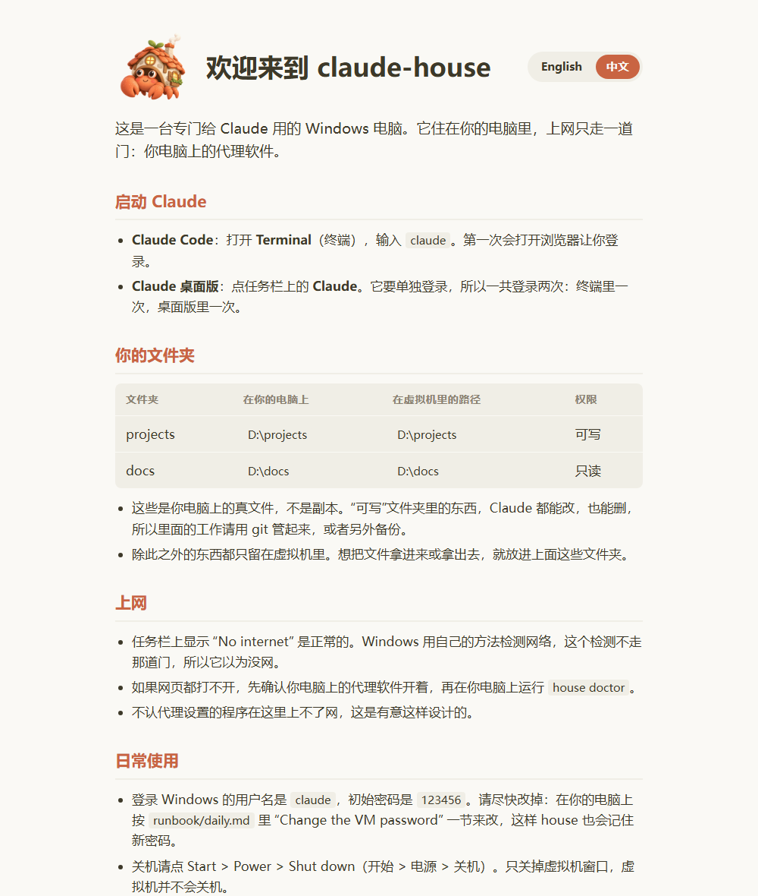
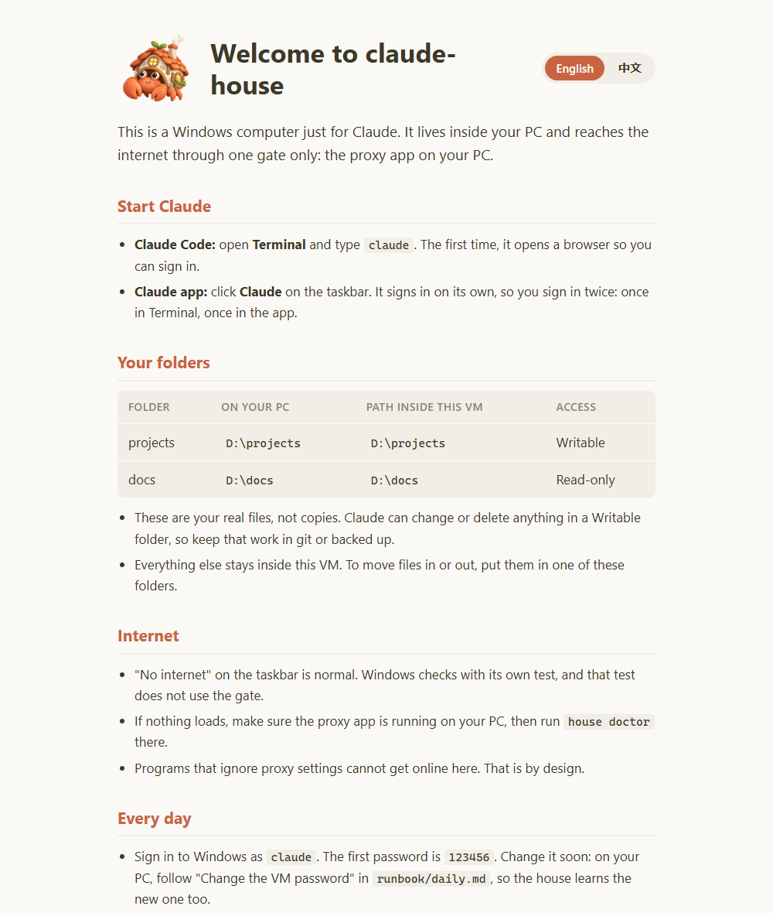
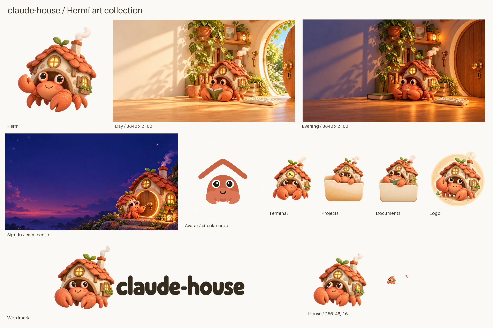

<p align="center">
  
</p>

<h1 align="center">claude-house</h1>

<p align="center">
  <b>让 Claude Code 在 Windows 上放手干活，又不用把整台电脑交给它。</b><br>
  给 Claude 一台独立的 Windows 11 电脑，以 Hyper-V 虚拟机的形式装在你的 PC 里。<br>
  由你自己的 agent 一步步搭起来。上网只走一个出口。只共享你选的文件夹。
</p>

<p align="center">
  <a href="../../actions/workflows/tests.yml"></a>
  <a href="LICENSE"></a>
  
  
  
  
  <a href="https://linux.do"></a>
  
</p>

<p align="center"><a href="README.md">English</a> · <b>简体中文</b></p>

你不用从我们这里安装任何东西。你的编程 agent 会读 runbook（操作手册），一步一步把小屋搭起来。每一步都带一个检查，用来证明这一步确实做完了。

> **状态：早期预览。** 已经在一台真实 PC 上从头到尾搭建并检查过，英文和中文 Windows 都试过。不过项目还很新，难免有不顺手的地方，遇到了请在 Issues 里告诉我们。
> 本项目与 Anthropic 无关，也没有得到 Anthropic 的认可。"Claude" 是 Anthropic, PBC 的商标。

中文 ISO 也能用：在配置里把 `House.Locale` 设为 `zh-CN`，`House.ImageName` 填中文版的版本名（例如 `Windows 11 专业版`），详见 [runbook/01-blueprint.md](runbook/01-blueprint.md)。虚拟机默认是英文界面、洛杉矶时区；想用北京时间，就把 `House.TimeZone` 改成 `'China Standard Time'`。

## 为什么要它

每条命令都点一次"允许"，很快就烦了，于是很多人干脆给 Claude Code 开自动接受，或者加 `--dangerously-skip-permissions` 跑。放在自己电脑上，这意味着一条错命令就能碰到你所有的东西。在原生 Windows 上，Claude Code 官方文档建议用容器、虚拟机或 WSL2 做沙箱；本仓库走的是虚拟机这条路，给想继续在 Windows 里干活的人用。

在小屋里，Claude 有自己的桌面、自己的磁盘、自己的工具。它只能碰到你共享进来的主机文件夹（只读还是可写由你定），上网也只能走你的代理。真出了事，损失关在小屋里。

## 你会得到什么

- 🏠 **给 Claude 一整套 Windows 11 桌面。** Claude Code、Claude 桌面应用、Git、Python、Node.js、GitHub CLI 和 VS Code 都会替你装好，Claude 也会固定到任务栏上。
- 🚪 **只有一个出口。** 虚拟机（VM）自己没有通往互联网的路由。所有流量都从同一道门出去，也就是你 PC 上已经在用的代理软件。
- 📁 **你的文件夹，路径不变。** 选好要共享的主机文件夹，在小屋里它们会出现在一模一样的路径下。只读还是可写，由你决定。
- 🛡️ **小屋规矩。** 一组 hook（钩子脚本）专门拦常见失误：在整个共享盘上搜索、在共享目录里删东西、Windows 命令的常见写法错误。
- ✅ **每一步都能自证。** `house check` 和 `house doctor` 会清楚告诉你哪些做完了、哪些还没有，并指出该怎么修。
- 🦀 **住着舒服。** 有壁纸、鼠标指针、图标，还有一个中英双语的 **Start here** 页面，主角是寄居蟹 Hermi。

## 看看里面

<table>
  <tr>
    <td width="50%"></td>
    <td width="50%"></td>
  </tr>
  <tr>
    <td align="center"><b>Start here</b>：小屋桌面上的第一个页面</td>
    <td align="center">点一下就能切到 English</td>
  </tr>
</table>

<p align="center">
  <br>
  <sub>小屋里的所有图片。出处见 <a href="assets/ART.md">assets/ART.md</a>。</sub>
</p>

## 需要什么

一台实体的 Windows 11 专业版、企业版或教育版 PC（x64），16 GB 内存（虚拟机固定占 8 GB，剩下的留给你自己），已开启硬件虚拟化，NTFS 或 ReFS 盘上有大约 100 GB 可用空间。Windows 家庭版、ARM 电脑，以及本身就是虚拟机的电脑，都装不了小屋。

虚拟机里跑的是一份独立的 Windows 11，需要它自己的 Windows 许可证。本项目不设置产品密钥。激活之前，虚拟机里的 Windows 会显示"激活 Windows"水印，部分"个性化"设置是灰的。这不影响 Claude。

动手改任何东西之前，先运行：

```powershell
powershell -NoProfile -ExecutionPolicy Bypass -File .\house.ps1 preflight
```

## 怎么搭

1. 在一台装了 Hyper-V 的 Windows 11 专业版/企业版/教育版 PC 上克隆本仓库。
2. 在**管理员**终端里启动你的 agent。我们用 Claude Code 搭建和测试；能读 AGENTS.md、能在你电脑上跑 PowerShell 的 agent（比如 Codex）也应该可以。第 0 步会检查当前 shell 有没有提权；而且大多数步骤要改 Hyper-V、网络或防火墙，这些都需要管理员权限。打开"开始"菜单，右键 **终端**（英文系统里叫 Terminal），选 **以管理员身份运行**（Run as administrator），然后：

   ```powershell
   cd <path to your clone>
   claude   # 或者 codex，换成你的 agent 的启动命令
   ```

   用管理员身份运行，也不等于 agent 可以绕过你：AGENTS.md 要求它把每条管理员命令先给你看，等你同意了才执行。
3. 对你的 agent 说：*"按照 AGENTS.md 搭建 claude-house。"*
4. agent 会按 runbook 一轮一轮地做：
   - `house next` 找出下一步该做什么；
   - `house step <id>` 显示这一步怎么做；
   - 它执行命令，遇到管理员命令都会先问你；
   - `house check <id>` 证明这一步已经做完。

`house doctor` 随时可以检查整个小屋。

设计思路见 [ARCHITECTURE.md](ARCHITECTURE.md)。

## 会改动你电脑上的什么

写成 `代码格式` 的名字，是 runbook 会创建的东西；方括号里的值来自你的蓝图（`house.config.psd1`），"默认"后面是示例配置里的默认值。虚拟机内部的一切都放在虚拟机自己的磁盘上，删掉虚拟机就一起没了。

| 步骤 | 主机上的改动 |
|---|---|
| 0 | 开启 Windows 功能 `Microsoft-Hyper-V`（包括它的全部组件）。需要重启。 |
| 1 | 在你克隆的仓库里写入 `house.config.psd1`。 |
| 2 | 一个内部 Hyper-V 虚拟交换机 [`Network.SwitchName`]（默认 `HouseNet`）。它在主机上的网卡 `vEthernet (HouseNet)` 拿到地址 [`Network.HostIP`]（小屋子网的 `.1`），并在这块网卡上关闭 IP 转发。如果检查发现有 NAT 和小屋子网重叠，并且你同意了，这个 NAT 会被删掉。 |
| 3 | IP Helper 服务（`iphlpsvc`）设为自动启动，并启动它。一条 portproxy 规则（`netsh interface portproxy`，v4tov4）把 [`HostIP`]:[`Network.GatePort`]（默认 3128）转发到 `127.0.0.1`:[`Network.ProxyAppPort`]。一条 Windows 防火墙入站规则 `claude-house gate`，只允许来自虚拟机地址的 TCP 连接访问这个出口端口。 |
| 4 | 一台第 2 代虚拟机 [`House.Name`]（默认 `claude-house`），开启安全启动（Secure Boot）和虚拟 TPM。它的文件和磁盘 `<House.Name>.vhdx` 放在 `<House.Path>\<House.Name>`。一个 Host Guardian Service 保护者 `claude-house-guardian` 负责保护虚拟 TPM；创建它时，还会在本地计算机证书存储（`Shielded VM Local Certificates`）里生成它的自签名签名证书和加密证书。这台 PC 上的所有小屋共用这一个保护者。 |
| 5 | 把 Windows 写入虚拟机磁盘。`C:\ProgramData\claude-house\<House.Name>\` 里多出 `vm-user.cred.xml`（虚拟机密码，按你的 Windows 账户加密）和 `windows-applied.json`。 |
| 6 | 公共桌面（`C:\Users\Public\Desktop`）上的快捷方式 `<House.Name>.lnk`，用来打开虚拟机控制台；它的图标复制到 `C:\ProgramData\claude-house\<House.Name>\house.ico`；另外还有一个控制台设置文件 `%APPDATA%\Microsoft\Windows\Hyper-V\Client\1.0\vmconnect.rdp.<VM id>.config`，属于运行这一步的那个用户。 |
| 10 | 一个本地 Windows 账户 `house-share`（不是管理员，密码永不过期）；它的密码只保存在 `C:\ProgramData\claude-house\<House.Name>\share-user.cred.xml`。`Shares` 里的每一项对应一个 SMB 共享，共享名取它的 `Name`，去掉 `Everyone`，给 `house-share` 读取（Read）或更改（Change）权限。每个共享文件夹上加一条给 `house-share` 的 NTFS 权限（读取和执行；可写时为修改），子文件夹会继承。共享文件夹原本不存在的，会被创建。一条 Windows 防火墙入站规则 `claude-house SMB`，只允许来自虚拟机地址的 TCP 445 连接。 |

第 7–9 步和第 11–14 步只改虚拟机内部。想把这些全部移除，按 [runbook/uninstall.md](runbook/uninstall.md) 操作。

## 第一次登录

双击桌面上的 **claude-house** 快捷方式（名字就是你的 `House.Name`）。Windows 每次都会弹出管理员确认（UAC，用户账户控制）：Hyper-V 控制台需要管理员权限，所以这个快捷方式被设成以管理员身份运行。这个弹窗是正常的。用 `claude`（或你设的 `House.UserName`）登录，密码是 `123456`。改密码的方法见 [runbook/daily.md](runbook/daily.md)。

在虚拟机桌面上双击 **Start here**。这是一个本地欢迎页，列出这间小屋的共享文件夹、工具和规矩，以及出问题时该怎么办。

虚拟机只接在内部交换机上，小屋的防火墙拦住入站流量，控制台和 PowerShell Direct 也都需要主机管理员权限。所以这个密码保护的东西，主机管理员本来就都能拿到。一旦有人在虚拟机里开了远程桌面，或者把它挪到外部交换机上，这个密码就不安全了。

## 和其他沙箱比

用沙箱跑 Claude Code 有不少好办法。按你的需要选：

| 方案 | 环境 | 长期保留？ | 主机路径在里面 | 上网 | 最适合 |
|---|---|---|---|---|---|
| Docker / 开发容器 | Linux | 按项目 | 挂载目录，Linux 路径 | 容器网络 | Linux 工具链、轻量 |
| WSL2 | Linux | 是 | `/mnt/c/...` 这类路径 | 共用主机网络 | 在 Windows 电脑上做 Linux 的活 |
| Windows 沙盒 | Windows | 否，关掉就清空 | 只有映射的文件夹 | 主机网络 | 临时试一下 |
| 云主机 | 任选 | 是，按时计费 | 没有，要把文件传上去 | 云端网络 | 电脑关机时也要跑 |
| **claude-house** | **Windows 11** | **是** | **和主机上同一个路径** | **只有一道门：你的代理** | **给 Claude 一台长期的 Windows 工作站** |

- **想要 Linux 环境：** 用 Docker Sandboxes，或者某个 Linux/macOS 虚拟机工具（比如 trailofbits/coop，或者基于 QEMU 和 Nix、每次会话都启动一台新虚拟机的那几个 `claude-vm` 项目）。它们比一整台 Windows 虚拟机轻。
- **想要用完就扔的 Windows 会话：** 看看 Windows 沙盒，或者基于 Hyper-V 的一次性沙箱，比如 agent-sandbox-vm。
- **想给 Claude 一台长期使用的 Windows 工作站：** 主机路径在里面照常能用，唯一的出口是通往你已有代理软件的那道门，每一步都由你自己的 agent 搭建和检查。这就是 claude-house。

## 许可证

MIT。见 [LICENSE](LICENSE)。
